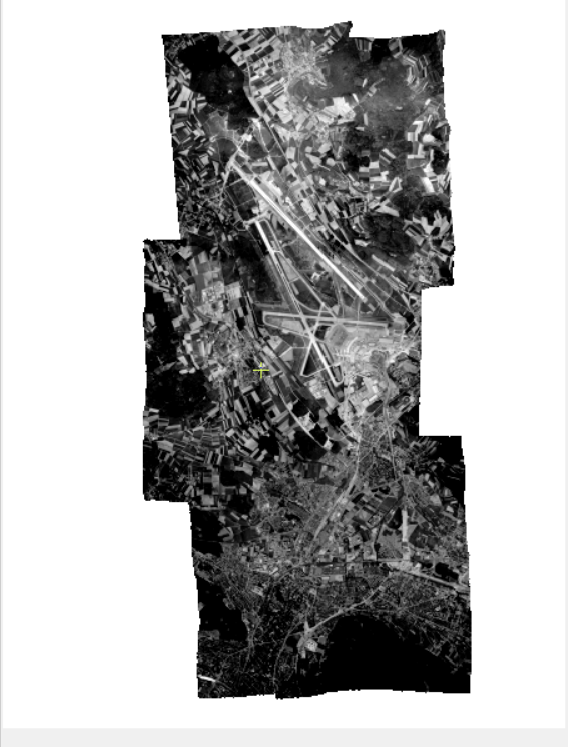
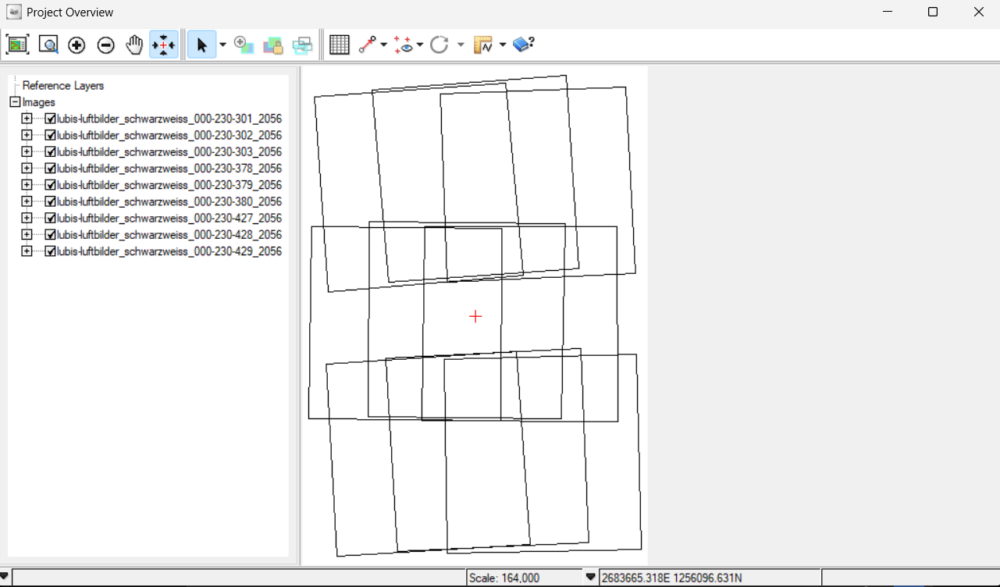
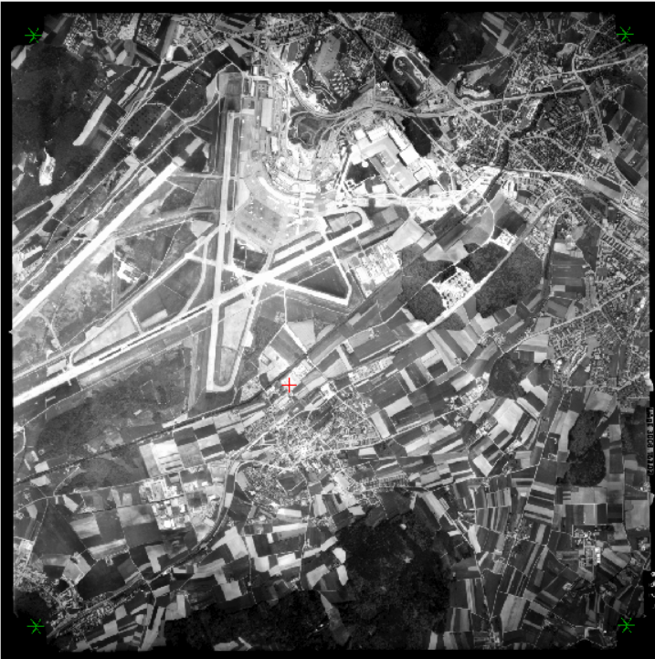
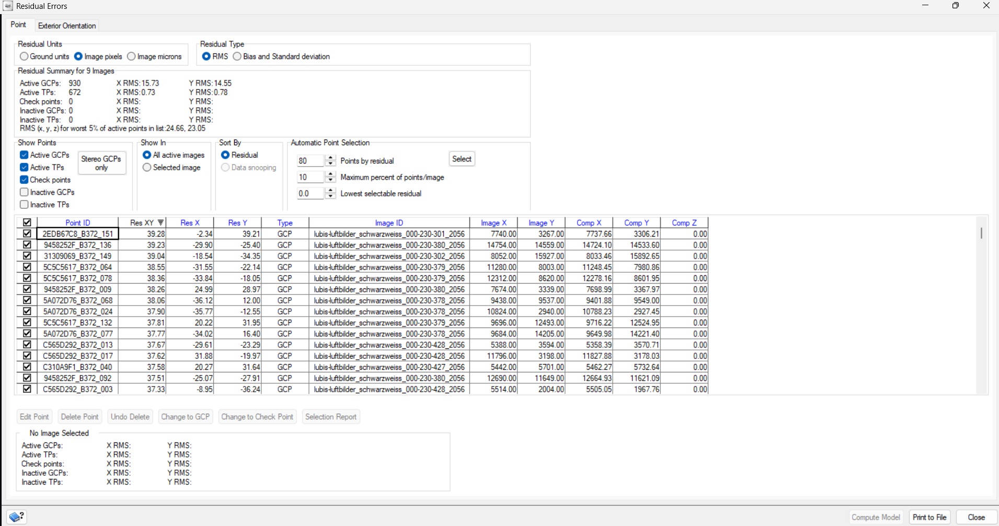
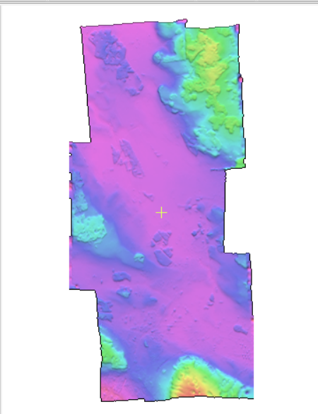
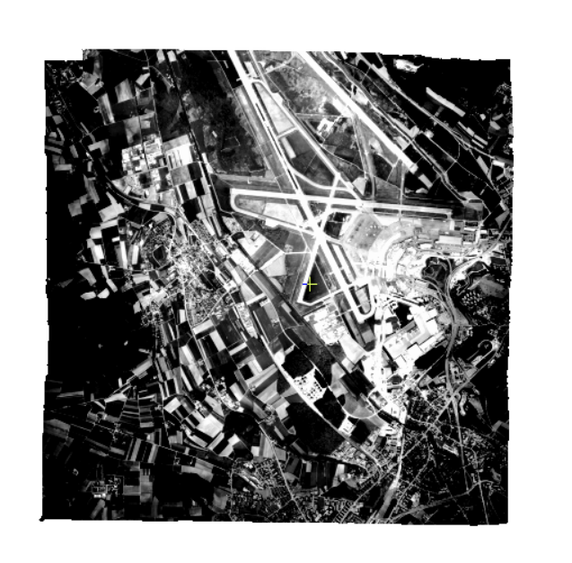
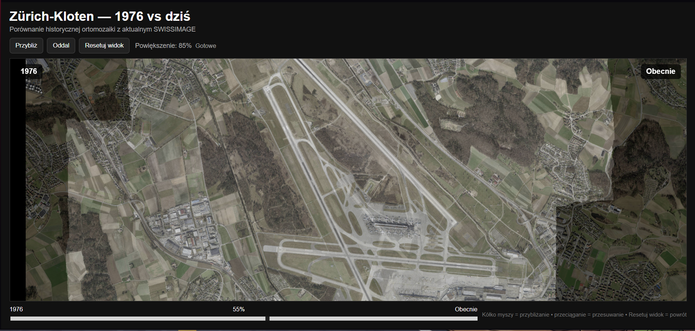

# Historyczna fotogrametria lotnicza — Zürich-Kloten 1976

Projekt przedstawia pełny workflow fotogrametrycznego przetwarzania historycznych analogowych zdjęć lotniczych z 1976 roku dla obszaru Zürich-Kloten w Szwajcarii.

Celem było odtworzenie geometrii historycznych zdjęć, wygenerowanie DSM, ortorektyfikacja całego bloku oraz przygotowanie finalnej ortomozaiki umożliwiającej porównanie zmian przestrzennych pomiędzy 1976 rokiem a stanem współczesnym.



## Najważniejsze rezultaty

- blok **9 zdjęć lotniczych** w układzie 3 × 3,
- rekonstrukcja orientacji wewnętrznej na podstawie znaków tłowych,
- kalibracja kamery **Wild RC10 / Universal Aviogon II**,
- punkty GCP oraz automatyczne tie points,
- Coarse i Fine Alignment,
- DSM wygenerowany z **6 par stereo** metodą SGM,
- ortorektyfikacja 9 zdjęć,
- finalna historyczna ortomozaika,
- kontrola jakości geometrycznej i wizualnej,
- porównanie **1976 vs współcześnie**,
- lokalny interaktywny viewer HTML.

## Dane

W projekcie wykorzystano:

- historyczne zdjęcia lotnicze — **swisstopo LUBIS**,
- współczesną ortofotomapę — **SWISSIMAGE 2 m**,
- referencyjny model terenu — **swissALTI3D 2 m**,
- certyfikat kalibracji kamery Wild RC10.

Finalne produkty zapisano w układzie:

**CH1903+ / LV95 — EPSG:2056**

Szczegółowy opis danych znajduje się w:

[`03_docs/data_sources.md`](03_docs/data_sources.md)

## Workflow

Główne etapy przetwarzania:

1. przygotowanie danych,
2. HAP Ingest,
3. orientacja wewnętrzna i fiduciale,
4. nominalne georeferencjonowanie,
5. zbieranie GCP,
6. generowanie tie points,
7. Coarse Alignment,
8. Fine Alignment,
9. kontrola residuali,
10. rekonstrukcja DSM,
11. ortorektyfikacja,
12. mozaikowanie,
13. finalna kontrola jakości,
14. porównanie historyczne.

Szczegółowy opis workflow:

[`05_methodology/workflow_notes.md`](05_methodology/workflow_notes.md)

## Układ bloku zdjęć

Do projektu wykorzystano 9 zdjęć:

```text
301   302   303
378   379   380
427   428   429
```



## Kalibracja kamery

Zdjęcia wykonano kamerą:

- **Wild RC10**
- **Universal Aviogon II nr 3008**
- ogniskowa kalibrowana: **153,02 mm**

Dla każdego zdjęcia wykorzystano cztery narożne znaki tłowe.

Automatyczna detekcja fiduciali uzyskała błędy poniżej **1 px** dla wszystkich 9 zdjęć.



Pełne parametry kalibracji:

[`05_methodology/camera_calibration.md`](05_methodology/camera_calibration.md)

## Alignment i kontrola jakości

Po zbieraniu GCP i automatycznym generowaniu tie points wykonano wieloetapowe wyrównanie bloku.

Po usunięciu najbardziej odstających GCP uzyskano:

| Parametr     |      RMS |
| ------------ | -------: |
| GCP X        | 15,73 px |
| GCP Y        | 14,55 px |
| Tie Points X |  0,73 px |
| Tie Points Y |  0,78 px |



## DSM

Model powierzchni został wygenerowany z **6 optymalnych par stereo**.

Zastosowano:

- **SGM — Semi-Global Matching**
- rozdzielczość końcową **1 × 1 m**
- Mean Sea Level
- scalanie wyników metodą Merge



Finalny produkt:

`04_outputs/DSM_1976.tif`

## Ortorektyfikacja

Wszystkie 9 zdjęć zostało ortorektyfikowanych przy użyciu wygenerowanego DSM.

Główne ustawienia:

- Sampling interval: `1`
- Resampling: `Cubic`
- Automatic edge clip: `5%`



## Finalna ortomozaika

Ortoobrazy połączono w CATALYST Mosaic Tool.

Zastosowano:

- cutlines: `Minimum squared difference`
- color balancing: `Bundle`
- blend width: `10 px`


Finalny produkt:

`04_outputs/historical_orthomosaic_1976.tif`

## 1976 vs współcześnie

Historyczną ortomozaikę porównano ze współczesnym SWISSIMAGE.

Najbardziej widoczne zmiany dotyczą:

- infrastruktury terminalowej,
- dróg kołowania,
- płyt postojowych,
- sieci drogowej,
- intensywności zabudowy,
- zmian użytkowania terenu wokół lotniska.



## Interaktywny viewer

W folderze:

[`02_comparison`](02_comparison)

znajduje się lokalny viewer HTML umożliwiający:

- zmianę przezroczystości rastrów,
- zoom,
- przesuwanie widoku,
- bezpośrednie porównanie 1976 roku ze stanem współczesnym.

Pliki:

```text
comparison.html
historical_1976_web.tif
current_web.tif
```

Uruchomienie lokalnie:

```bash
cd 02_comparison
python -m http.server 8000
```

Następnie:

```text
http://localhost:8000/comparison.html
```

## Wykorzystane narzędzia

### CATALYST Professional

- Historical Airphoto Processing
- OrthoEngine
- Mosaic Tool
- Focus

### QGIS

- przygotowanie danych referencyjnych,
- łączenie i przycinanie rastrów,
- eksport wyników,
- kontrola GeoTIFF,
- przygotowanie danych porównawczych.

### HTML / JavaScript

- lokalny interaktywny viewer.

## Struktura repozytorium

```text
.
├── README.md
├── 01_assets/
│   ├── 01_block_overview.png
│   ├── 02_fiducials.png
│   ├── 03_alignment_qa.png
│   ├── 04_dsm_1976.png
│   ├── 05_ortho_379.png
│   ├── 06_final_orthomosaic.png
│   └── 07_historical_vs_current.png
├── 02_comparison/
│   ├── comparison.html
│   ├── current_web.tif
│   └── historical_1976_web.tif
├── 03_docs/
│   ├── case_study.pdf
│   └── data_sources.md
├── 04_outputs/
│   ├── DSM_1976.tif
│   └── historical_orthomosaic_1976.tif
└── 05_methodology/
    ├── camera_calibration.md
    └── workflow_notes.md
```

## Case study

Case study projektu:

[`03_docs/case_study.pdf`](03_docs/case_study.pdf)

## Rezultat

Projekt pokazuje praktyczne połączenie:

- fotogrametrii,
- GIS,
- przetwarzania danych rastrowych,
- kontroli jakości danych przestrzennych,
- analizy zmian w czasie,
- prezentacji wyników w środowisku webowym.
